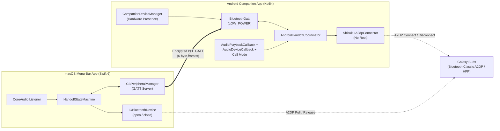

# Samsung Switch

**Samsung Switch** is a dual-platform, ultra-lightweight native utility that brings seamless **Galaxy Buds Auto-Switch** between **macOS** and **Android (Samsung One UI)** over an encrypted **Bluetooth Low Energy (BLE) GATT** control channel — without Wi-Fi, cloud accounts, or modifications to your earbuds.

---

## Highlights & Resource Budgets

- **macOS (`macos/`):** Pure **Swift 6 + AppKit** menu-bar daemon (`CoreBluetooth`, `IOBluetooth`, `CoreAudio`). Zero polling timers, zero Electron/WebViews — **< 20 MB RAM** and **~0.0% idle CPU**.
- **Android (`android/`):** Pure **Kotlin** companion app (`minSdk 31` / Android 12+). Uses hardware-offloaded `CompanionDeviceManager` presence detection, `CONNECTION_PRIORITY_LOW_POWER`, **zero WakeLocks**, **zero continuous BLE scanning**, and **zero `INTERNET` or location permissions**. Audio listeners register **only while connected to your Mac**.
- **Galaxy Buds:** Zero firmware changes and zero extra Bluetooth connections; switching looks like a normal host audio handoff.
- **Security:** Mandatory OS-level **BLE Bonding** (`.writeEncryptionRequired` / `.readEncryptionRequired`) protects every 6-byte frame in [`protocol/spec.md`](protocol/spec.md).

---

## Architecture & Handoff Behavior



### How Switching Works

- **Phone → Mac:** Start playing audio on macOS → after a **400 ms debounce** (filtering brief notification dings), the Mac sends `CLAIM(MEDIA)`, Android pauses local playback and releases its Buds profiles via Shizuku, and the Mac pulls the Galaxy Buds via `IOBluetoothDevice.openConnection()`.
- **Mac → Phone (Media):** Start playing media on your Samsung phone → after a **400 ms debounce**, Android sends `CLAIM(MEDIA)`, macOS pauses local playback (with Accessibility enabled) and calls `IOBluetoothDevice.closeConnection()`, and Android reconnects the Buds via Shizuku.
- **Mac → Phone (Call Priority):** Incoming or active phone/VoIP calls preempt macOS audio immediately (**0 ms debounce**) and hold `CALL_LOCK` until the call ends.
- **Anti-Ping-Pong & Sleep Hygiene:** A **2.5 s post-handoff cooldown** drops speaker-migration bounces, and sleeping/closing your Mac lid pauses BLE advertising and releases the Buds back to your phone cleanly.

---

## Prerequisites

### macOS
- **macOS 14 (Sonoma)** or later (Apple Silicon or Intel)
- **Xcode Command Line Tools** (`xcode-select --install`) or Xcode with Swift 6 toolchain
- Galaxy Buds paired with your Mac in **System Settings → Bluetooth**

### Android (Samsung One UI)
- Samsung phone running **Android 12+ (API 31+)**
- **Galaxy Wearable** app with **Seamless earbud connection** enabled (`Earbuds settings → Seamless earbud connection`)
- **Shizuku** installed and running (no root required — works over Wireless Debugging or `adb`)
- For building from source: **JDK 17** and Android SDK (API 35) / Android Studio, plus `adb` (`platform-tools`)

---

## Setup Guide

### Step 1 — Prepare Bluetooth on Both Devices
1. Pair your **Galaxy Buds** to both your **Samsung phone** and your **Mac**.
2. On your Samsung phone, open **Galaxy Wearable → Earbuds settings** and turn on **Seamless earbud connection**.
3. Pair your **Mac** and **Samsung phone** once in standard **Bluetooth settings** (this ensures OS-level BLE bonding works smoothly).

### Step 2 — Install & Launch the macOS Menu-Bar App

Build the release binary, package `~/Applications/SamsungSwitch.app`, ad-hoc sign it (for stable macOS permissions across updates), and install the background `LaunchAgent`:

```bash
./scripts/install-macos-agent.sh
```

> Prefer running temporarily without installing a `LaunchAgent`? Run `cd macos && swift run SamsungSwitch`.
> To uninstall later: `./scripts/uninstall-macos-agent.sh`.

1. Grant **Bluetooth** access when macOS prompts (`Samsung Switch` appears as a wave icon in the top menu bar).
2. *(Recommended)* Click the **Samsung Switch** menu-bar icon → **Enable Mac Auto-Pause (Accessibility)...** and approve it in **System Settings → Privacy & Security → Accessibility** so macOS automatically pauses local playback when your phone takes the Buds.

### Step 3 — Start Shizuku on Your Samsung Phone
1. Install [Shizuku](https://shizuku.rikka.app/) on your Samsung phone.
2. Start the Shizuku service (via **Wireless Debugging** on-device, or `adb shell sh /sdcard/Android/data/moe.shizuku.privileged.api/start.sh`).
3. Confirm Shizuku shows **Running**.

*(Why Shizuku? On models like Galaxy Buds3 Pro, the Buds stay idle after macOS closes A2DP instead of auto-reconnecting on their own; Shizuku grants shell-level `IBluetooth` access without root to deterministically connect/disconnect audio profiles.)*

### Step 4 — Build & Install the Android App

```bash
cd android
./gradlew assembleDebug
adb install -r app/build/outputs/apk/debug/app-debug.apk
```

*(If multiple ADB targets are attached, pass `-s <device-serial>`.)*

### Step 5 — Pair Mac ↔ Phone Inside Samsung Switch
1. Open **Samsung Switch** on your Android phone and grant **Nearby devices (`BLUETOOTH_CONNECT`)** permission.
2. Make sure the macOS menu-bar app is running (`BLE: Advertising (Waiting for Phone)`).
3. Tap **Pair Mac (CompanionDevice)** and select **Samsung Switch** (your Mac) in the system picker.
4. Accept the **OS Bluetooth pairing/bonding prompt** on both the phone and Mac if shown.
5. Tap **Authorize Shizuku A2DP** and allow Shizuku access for Samsung Switch.
6. Verify the status reads:
   - `BLE Status: Connected (LOW_POWER)`
   - `Associated Mac: Paired (Presence Offload Enabled)`
   - `Shizuku A2DP: Ready`

You're ready! Play audio on either device to switch automatically.

---

## Menu-Bar & App Controls

- **macOS Menu Bar:**
  - **Auto-Switch Enabled:** Pause/resume automatic handoff without stopping the BLE link.
  - **Pull Buds Here (`⌘P`):** Manually pull Galaxy Buds to the Mac.
  - **Release Buds to Phone:** Manually release Galaxy Buds back to the Samsung phone.
  - **Mac Auto-Pause (Accessibility):** Shows whether macOS auto-pause permission is authorized.
  - **Copy Diagnostic Summary:** Copies live BLE/audio/state-machine diagnostics to your clipboard.
  - **Restart BLE Advertising (`⌘R`):** Re-starts BLE GATT advertising if needed.
- **Android App:**
  - **Auto-Switch Enabled** toggle, **Test Buds A2DP (Shizuku)** button, **Connect GATT** / **Disconnect**, and live `Ownership` + `Last RX` / `Last TX` diagnostics.

---

## Development, Testing & Verification

### macOS
```bash
cd macos
swift build
swift test
swift build -c release
```

### Android
```bash
cd android
./gradlew testDebugUnitTest --rerun-tasks assembleDebug lintDebug --console=plain
```

For the 6-byte binary BLE GATT framing specification and cross-platform hex test vectors, see [`protocol/spec.md`](protocol/spec.md).

---

## Troubleshooting

| Symptom | Fix |
|---|---|
| BLE stuck on `Pairing / Bonding...` or `Connecting GATT...` | Forget the Mac/phone Bluetooth pairing in OS Bluetooth settings on both devices, tap **Restart BLE Advertising** on Mac, then re-run **Pair Mac (CompanionDevice)** on Android. |
| Mac audio keeps playing when Buds switch to Phone | Click the menu-bar icon → **Enable Mac Auto-Pause (Accessibility)...**, grant access in System Settings, and reopen the menu bar to confirm **Mac Auto-Pause: Authorized**. |
| Buds disconnect from Mac when playing on Phone, but don't reconnect to Phone | Verify Shizuku is running and **Shizuku A2DP: Ready** shows in Samsung Switch (tap **Authorize Shizuku A2DP** after rebooting your phone). |
| Mac fails to pull Buds while playing on Phone | Confirm **Seamless earbud connection** is enabled in Galaxy Wearable and your Buds are already paired to the Mac. |

---

## Privacy & License

- **Zero telemetry, zero cloud servers, zero internet permissions:** Neither app requests internet access or collects analytics.
- Released under the [MIT License](LICENSE).
